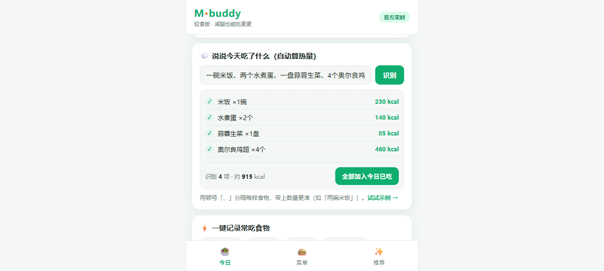

# 🥗 M·buddy 轻食版 — 麦当劳减脂点餐助手

> 适合减脂 / 健身 / 体重管理人群的麦当劳点餐小程序。先记录你今天吃了什么，系统算出还能吃多少，再按**性价比最高 / 热量最低 / 高蛋白增肌 / 均衡营养**四种策略，推荐合适的麦当劳减脂套餐组合。
>
> 数据来自 **麦当劳中国官方 MCP**（`list-nutrition-foods` + `query-nearby-stores` + `query-meals`），当前内置数据为 **2026-10-14 官方实时拉取**（示例门店：广州·天河），可随时用 Token 重新刷新。

---

## ✨ 功能

- **单品热量标注**：每个麦当劳单品在点餐界面都标注千卡，并展示蛋白 / 脂肪 / 碳水 / 钠。
- **口语化记账（自动算热量）**：不用你查热量——直接说人话，如「一碗米饭、两个水煮蛋、一盘蒜蓉生菜、4个奥尔良鸡翅」，系统自动拆句、识别食物与数量、估算热量，确认后计入今日已吃。
- **今日已吃录入**：除口语识别外，也支持常吃食物一键速记与手动补录（识别不到的食物可单独填热量）。
- **营养与热量情况**：用环形进度展示剩余额度，并给出达标 / 偏紧 / 超标的状态与建议。
- **多策略套餐推荐**：在剩余预算内组合「主食 + 可选小食 + 饮品」，给出四种最优方案：
  - 💰 **性价比最高**：预算内最大化「蛋白质 / 元」
  - 🔥 **热量最低**：预算内最小化总热量
  - 💪 **高蛋白增肌**：预算内最大化蛋白质、压低脂肪
  - ⚖️ **均衡营养**：宏量比例尽量接近 蛋白30% / 脂肪25% / 碳水45%
- **官方实时数据**：当前 `assets/menu-data.js` 已由官方 MCP 真实拉取（154 个餐品、含分类与实时价格），覆盖内置快照。
- **一键下单（连接麦当劳官方 MCP）**：选好单品加入购物车 → 选门店 / 取餐方式 → 调官方 `calculate-price` 试算（含优惠）→ 二次确认弹窗 → 调官方 `create-order` 创建**真实订单**并拿到订单号与支付链接。下单走**本地后端代理**，Token 仅在后端使用、绝不下发到前端。

## 🎯 目标用户

- **减脂期人群**：想在有限热量预算内吃饱、吃够蛋白质，不想每餐都自己算。
- **健身增肌人群**：需要在麦当劳这类快餐里挑出高蛋白、低脂肪的组合。
- **日常控卡的上班族**：午餐只能吃麦当劳，但不想一天热量超标。
- **不会算热量的小白**：只会说「一碗米饭、两个水煮蛋」这类日常表达，不想查营养成分表。

## 📖 使用示例

### 示例 1：口语化记账（不用查热量，说人话就行）

在「今日」页输入：

```
一碗米饭、两个水煮蛋、一盘蒜蓉生菜、4个奥尔良鸡翅
```

系统自动拆句识别，输出 4 项并折算热量：

| 识别结果 | 数量 | 热量 |
| --- | --- | --- |
| 米饭 | ×1 碗 | 230 kcal |
| 水煮蛋 | ×2 个 | 140 kcal |
| 蒜蓉生菜 | ×1 盘 | 85 kcal |
| 奥尔良鸡翅 | ×4 个 | 460 kcal |
| **合计** | — | **915 kcal** |

确认后一句话计入「今日已吃」，环形进度条同步更新剩余额度（附「达标 / 偏紧 / 超标」判断）。

### 示例 2：四策略套餐推荐

设每日目标 1500 kcal、已摄入 915 kcal → 剩余 585 kcal。点「推荐」页，系统在剩余预算内组合「主食 + 可选小食 + 饮品」，同时给出四种方案：

| 策略 | 优化目标 | 适合谁 |
| --- | --- | --- |
| 💰 性价比最高 | 预算内 max(蛋白质 / 元) | 学生、日常省钱 |
| 🔥 热量最低 | 预算内 min(总热量) | 严格控卡、刚吃完大餐 |
| 💪 高蛋白增肌 | 预算内 max(蛋白质 − 0.3×脂肪) | 健身增肌、力量训练后 |
| ⚖️ 均衡营养 | 宏量比例逼近 蛋白30%/脂肪25%/碳水45% | 日常保持健康 |

每个方案都展示单品清单、总热量、蛋白/脂肪/碳水、钠、价格，并标注是否在今日剩余预算内。

### 示例 3：一键下单（连接麦当劳官方 MCP）

1. 菜单页点「仅可下单」筛选（仅显示 32 个带有效官方编码的单品）。
2. 点单品的 🛒 加入购物车，如：巨无霸 ×1、中薯条 ×1。
3. 进「🛒 下单」页 → 选门店（默认麦当劳广州天源路餐厅 `1400359`）→ 选「到店自取」。
4. 点「① 计算价格（含优惠）」→ 官方 `calculate-price` 实时试算：**¥39.00**（巨无霸 ¥25.50 + 中薯条 ¥13.50）。
5. 点「② 确认下单」→ 二次确认弹窗 → 确认后官方 `create-order` 建单成功，返回**订单号**与**支付 H5 链接**。
6. 支付链接是 H5 扫码支付页，微信内打开即可长按识别付款，也可用麦当劳 App 扫一扫；**不强制安装 App**。

## 📸 界面预览



> 「一碗米饭、两个水煮蛋、一盘蒜蓉生菜、4个奥尔良鸡翅」→ 自动识别 4 项、估算 915 kcal，一键计入今日已吃。

---

## 🚀 安装与运行（4 种用法）

### 用法 A：直接打开 Web 小程序（最简单）
用浏览器打开 `index.html` 即可（移动端体验最佳）。无构建、无依赖、可离线运行。
要部署到公网：把整个仓库推到 GitHub 后开启 **Pages**（见下文「发布到 GitHub」）。
> 说明：直接打开 / GitHub Pages 静态版可完整使用「热量标注 · 口语记账 · 套餐推荐」，但**一键下单需本地后端代理**（见用法 D），因为浏览器不能直连 `mcp.mcd.cn`（CORS + Token 泄露风险）。

### 用法 B：作为 WorkBuddy Skill 使用
1. 在 WorkBuddy 左侧【连接器】配置麦当劳 MCP（见 `mcp-config.example.json`）。
2. 导入本仓库的 `SKILL.md` 作为 Skill。
3. 对话中直接说：「帮我用麦当劳点个减脂套餐」「我今天已吃xxx，还能吃多少」。

### 用法 C：刷新为官方实时营养数据
```bash
# 1) 在 https://open.mcd.cn 控制台登录并申请 MCP Token
# 2) 用环境变量传入 Token 运行同步脚本（默认取广州·天河门店，可用 MCD_CITY/MCD_KEYWORD 切换）
export MCD_MCP_TOKEN=你的_token
node scripts/sync-nutrition.mjs
# → 依次调用 list-nutrition-foods / query-nearby-stores / query-meals
# → 三源合并写入 assets/menu-data.js（live:true）
```
> 价格说明：示例门店当前在售约 35 个核心单品有精确实时价；其余单品界面显示「门店价」，推荐组合若含无价单品标注「含门店实时价」，均不编造价格。

### 用法 D：启用「一键下单」（本地后端代理，真实调用官方 MCP）
下单必须走后端，浏览器不能直连 `mcp.mcd.cn`。本地起一个 Node 代理即可。

**① 本机（Mac / Linux / Git Bash）**
```bash
export MCD_MCP_TOKEN=你的_token      # 也可直接写入 .env，见下
node scripts/serve.mjs
# 打开 http://localhost:5173 → 「🛒 下单」页
```

**② 本机（Windows PowerShell）**
> Windows 不认 `export` / `MCD_MCP_TOKEN=...` 这种写法，请用下面任一方式：
```powershell
# 方式一：用环境变量（当前窗口有效）
$env:MCD_MCP_TOKEN="你的_token"; node scripts/serve.mjs

# 方式二（最简单）：Token 已写入 .env，直接启动即可，无需输 token
node scripts/serve.mjs
```
> `.env` 内容形如 `MCD_MCP_TOKEN=你的token`，已被 `.gitignore` 忽略、不会入库；`serve.mjs` 启动时会自动读取。

**③ 手机访问（同一 Wi-Fi）**
1. 电脑按上面启动 `serve.mjs`，控制台会打印一行 `📱 手机访问（同一 Wi-Fi）：http://192.168.x.x:5173`（即电脑的内网 IP）。
   > ⚠️ 若电脑装了 VPN（如 VeeeVPN / outline），会出现 `10.x`、`169.254.x`、`172.x` 之类的**虚拟网卡地址**，手机连不到，只用 `192.168.x.x` / `198.168.x.x` 这类 WLAN 真实网卡 IP。`serve.mjs` 已自动跳过 VPN/蓝牙/链路本地网卡，只打印可用地址。
2. 手机连**同一个 Wi-Fi**，浏览器打开那个 `http://192.168.x.x:5173` 即可，体验与电脑一致（热量标注 / 口语记账 / 套餐推荐 / 🛒 下单）。
3. 若手机打不开：多半是 Windows 防火墙拦了 5173 端口——在「Windows Defender 防火墙 → 高级设置 → 入站规则」新建规则，允许 TCP 端口 **5173**（或允许 `node.exe` 通过防火墙）。
4. ⚠️ 手机与电脑必须在**同一局域网**（同一路由器 / 同一热点）；用蜂窝流量或不同网络打不开。公网访问需自行部署带后端的服务（见下「部署到公网」）。

> 说明：GitHub Pages 等纯静态托管没有后端，手机端只能用到「热量 / 记账 / 推荐」，下单需本地起 `serve.mjs` 后端（或部署到支持后端的平台）。

**④ 部署到公网（Render，一次部署后不再受 IP 影响）**

本地方案的 IP 会随着网络变化（实测同一台机器在三个网络下分别为 `192.168.101.61` / `172.20.10.14` / `192.168.66.158`，每换一次网络就要改一次地址）。部署到 Render 后拿到**固定 https 域名**，手机走流量、换 WiFi、在外都能用，也不用再管电脑内网 IP。

想把「下单」也放到手机任意网络都能用，需把 `serve.mjs` 部署到支持 Node 后端的平台（如 Render / Railway / Fly.io），并把 `MCD_MCP_TOKEN` 设为平台环境变量：

**Render 一键部署步骤：**
1. 把仓库推到 GitHub（`.env` 已被 `.gitignore` 忽略，Token 不会泄露）。
2. 打开 [render.com](https://render.com) → **New → Blueprint** → 选择该仓库（会自动读取根目录 `render.yaml`）。
3. 在环境变量里填写（建议勾选 secret）：

| 变量 | 说明 |
| --- | --- |
| `MCD_MCP_TOKEN` | 麦当劳 MCP Token（必填） |
| `ORDER_MODE` | `readonly` = 只读演示，**禁止**下单 / 取消 / 查订单（推荐用于公开 Demo）；`full` = 允许下单 |
| `ORDER_ACCESS_CODE` | 设置后所有接口调用须输入此口令才可用，防止他人盗用 Token 下单；只读模式可留空 |

4. 部署完成即可拿到 `https://m-buddy-xxxx.onrender.com`，手机直接打开。

> 💤 Render 免费版闲置约 15 分钟会休眠，首次打开需等待 30–60 秒。

```bash
# 其它平台（Railway / Fly.io 等）通用启动命令：
node scripts/serve.mjs
```
> ⚠️ **安全红线**：公网部署 = `/api/mcp` 对所有人开放。若 `ORDER_MODE=full` 且不设 `ORDER_ACCESS_CODE`，**任何拿到网址的人都能用你的 Token 创建真实麦当劳订单**（订单会真实进你的麦当劳账户，大量下单还可能触发风控导致 Token 被封）。公开 Demo 强烈建议 `ORDER_MODE=readonly`，或至少设置强口令。仅是这样也无法完全避免 Token 落地服务端，故建议只使用演示用 Token，不要用主账号生产 Token。
- 代理仅做转发：`POST /api/mcp { tool, args }` → 官方 MCP，返回结果；**Token 只在后端内存使用**，前端永远拿不到。
- `.env` 已被 `.gitignore` 忽略，Token 绝不入库。
- 下单流程：选单品 → 购物车 → 选门店（默认麦当劳广州天源路餐厅 1400359）→ 选取餐方式 → 「计算价格」调 `calculate-price`（含优惠）→ 二次确认弹窗 → 「确认下单」调 `create-order` 拿到**订单号 + 支付 H5 链接**，到麦当劳 App / 扫码支付。
- 菜单顶部有「全部单品 / 仅可下单」筛选。实测 **32 个**单品带有效官方 `productCode`（巨无霸、板烧、麦辣鸡翅、薯条、可乐、安格斯等）可一键下单；其余单品（早餐、部分套餐、雪碧等）无有效编码，其 🛒 按钮显示为**灰色 🔒**，点它会提示「暂无官方下单编码」，但用旁边的 **＋** 仍可加入「今日已吃」记录热量。
- 当前演示版支持「到店自取」；「麦乐送」需配送地址，已预留 `beType=2` 分支。

---

## 📁 项目结构

```
m-buddy/
├── index.html                 # 移动端点餐小程序界面
├── package.json               # 脚本入口（npm run serve / sync / start）
├── render.yaml                # Render 一键部署蓝图（可选）
├── assets/
│   ├── style.css              # 样式（移动端优先）
│   ├── app.js                 # 界面逻辑 + 减脂套餐推荐引擎 + 购物车下单流程
│   ├── food-db.js             # 常见食物热量库 + 口语化摄入解析器
│   └── menu-data.js           # 菜单营养数据（官方 MCP 实时拉取，live:true）
├── docs/                      # 界面截图（README 用）
├── scripts/
│   ├── sync-nutrition.mjs     # 调用官方 MCP 拉取实时营养与菜单的脚本
│   └── serve.mjs              # 预览服务器 + 麦当劳 MCP 代理（/api/mcp，Token 仅后端）
├── data/                      # 官方原始响应存档
├── SKILL.md                   # WorkBuddy Skill 定义
├── MCP_INTEGRATION.md         # 麦当劳 MCP 集成说明（官方必交）
├── CONTEST_DECLARATION.md     # 参赛声明（官方必交，内容原文不可改）
├── README.md                  # 本文件（官方必交）
├── workbuddy.md               # WorkBuddy 开发对话上下文（专项奖励必交）
└── mcp-config.example.json    # 脱敏 MCP 配置示例（自加，仅环境变量占位）
```

## 📊 数据来源与说明

- **权威源**：麦当劳中国官方 MCP `list-nutrition-foods`（实时）。
- **口语化摄入估算**：`assets/food-db.js` 内置约 100 种常见食物（家常菜 / 主食 / 水果 / 饮品 / 外卖大餐）的**常见估算值**（每份或每 100g），按数量折算；极端份量、菜品做法差异会有偏差，属正常范围。
- **内置快照**：多方公开资料核实（麦当劳中国官网营养计算器 2025-04、百度健康、什么值得买测评），热量 / 蛋白 / 价格会因地区、商圈、季节促销而变动，以官方实时数据为准。
- ⚠️ **免责声明**：本工具为参赛创意作品，输出仅供参考，**不构成医疗 / 营养专业建议**；餐品信息、价格及供应状态以麦当劳官方渠道实时结果为准。

---

## 🏆 参赛与发布（麦当劳程序员创意开发大赛）

本项目为「麦当劳程序员节创意开发大赛」参赛作品，真实使用官方 MCP 能力。

### 提交材料对照（官方要求）

| 序号 | 文件 | 官方要求 | 本项目 |
| --- | --- | --- | --- |
| 1 | `README.md` | 必须，文件名不可改 | ✅ 项目介绍 / 安装方法 / 使用示例 / 目标用户 |
| 2 | `CONTEST_DECLARATION.md` | 必须，文件名及内容均不可改 | ✅ 直接使用官方原文，未改动 |
| 3 | `MCP_INTEGRATION.md` | 必须，文件名不可改 | ✅ MCP Server / Tool / 调用流程 / 业务价值 |
| 4 | 源代码 | 必须，形式不限 | ✅ `index.html` + `assets/` + `scripts/`，无构建可直接运行 |
| 5 | `workbuddy.md` | 非必须；WorkBuddy 专项奖励必交，文件名不可改 | ✅ 含需求、决策、迭代与验证记录 |

### 发布到 GitHub（公开仓库）
```bash
git init
git add .
git commit -m "M-buddy 轻食版：麦当劳减脂点餐助手（官方 MCP 集成）"
git branch -M main
git remote add origin https://github.com/YPO0913/m-buddy.git
git push -u origin main
```
> 仓库需为 **Public**（Settings → General → 底部 Change visibility → Make public）。
> `.env`（含 Token）已被 `.gitignore` 忽略，不会被提交；推送前可用 `git status` 确认列表里没有 `.env`。
> 如需网页版，在仓库 Settings → Pages 选择 `main` 分支根目录发布。

### 报名 Issue（在活动主仓库提交）

标题自定义（如「报名申请」）。正文按官方格式：**【参赛申请】单独一行，之后每个字段各占一行，字段名与内容写在同一行、中间不要换行；项目地址用纯文本，不要用 Markdown 链接语法。**

```
【参赛申请】
项目名称：M·buddy 轻食版
项目地址：https://github.com/YPO0913/m-buddy
项目简介：面向减脂健身人群的麦当劳点餐助手，用口语记录当日已吃自动折算热量，再按性价比、最低热量、高蛋白增肌、均衡营养四种策略推荐官方实时营养套餐，并可一键连接麦当劳 MCP 真实下单。
```

- 活动主仓库：https://github.com/M-China/mcd-developer-innovation-challenge
- MCP 文档：https://open.mcd.cn/mcp/doc

---

© 参赛作品 · 非麦当劳官方产品
